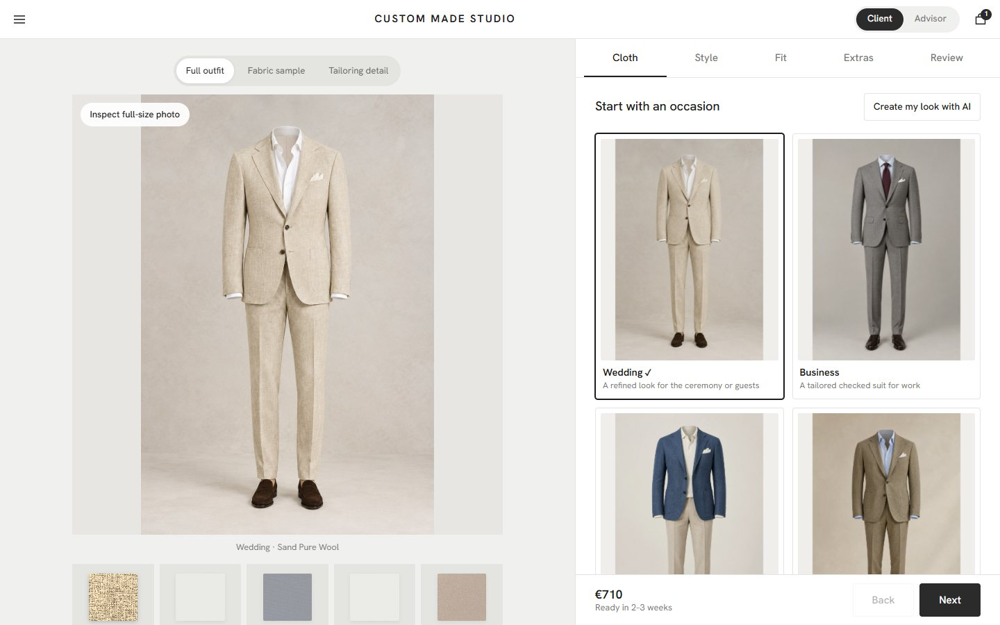
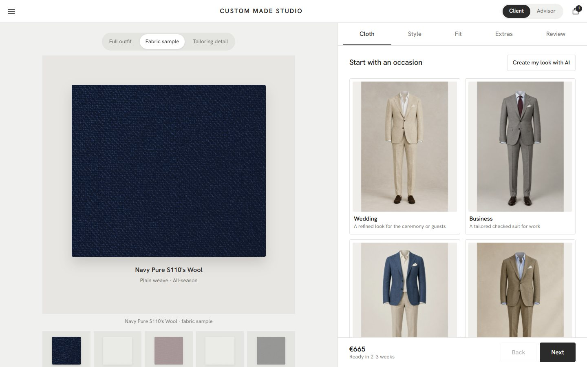
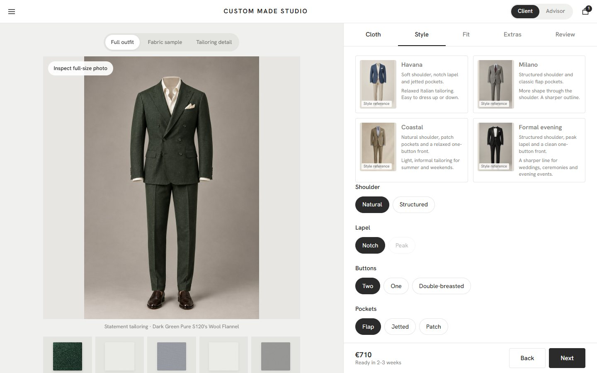
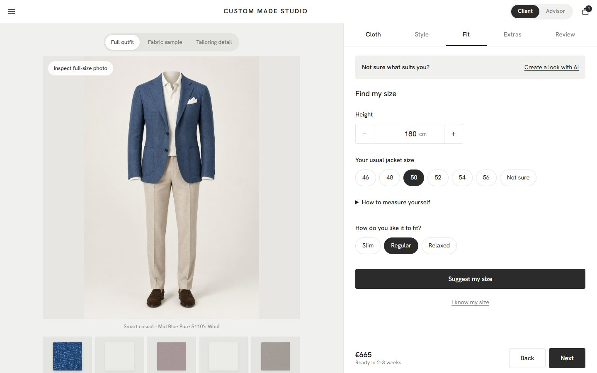
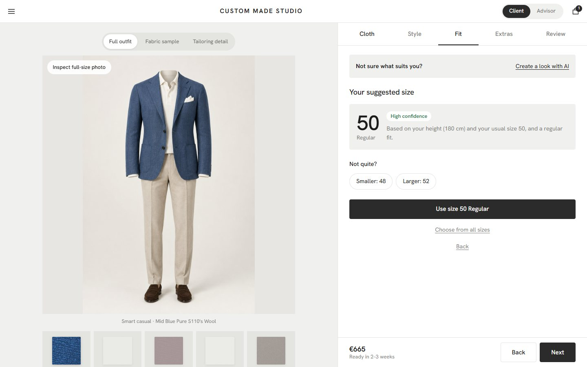
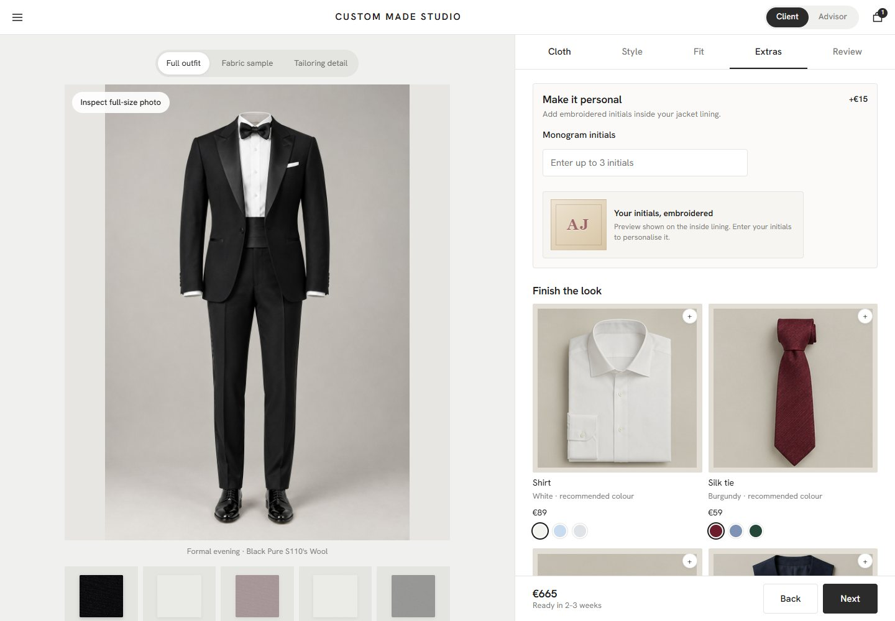
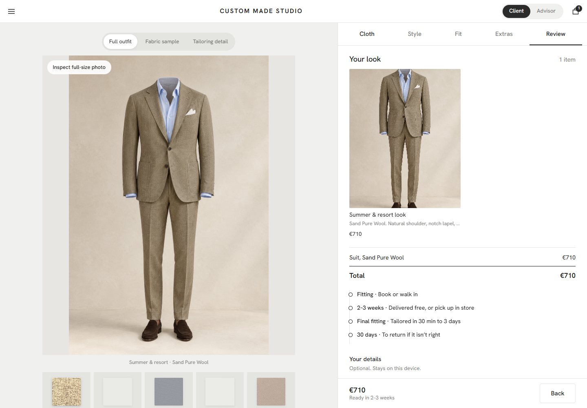
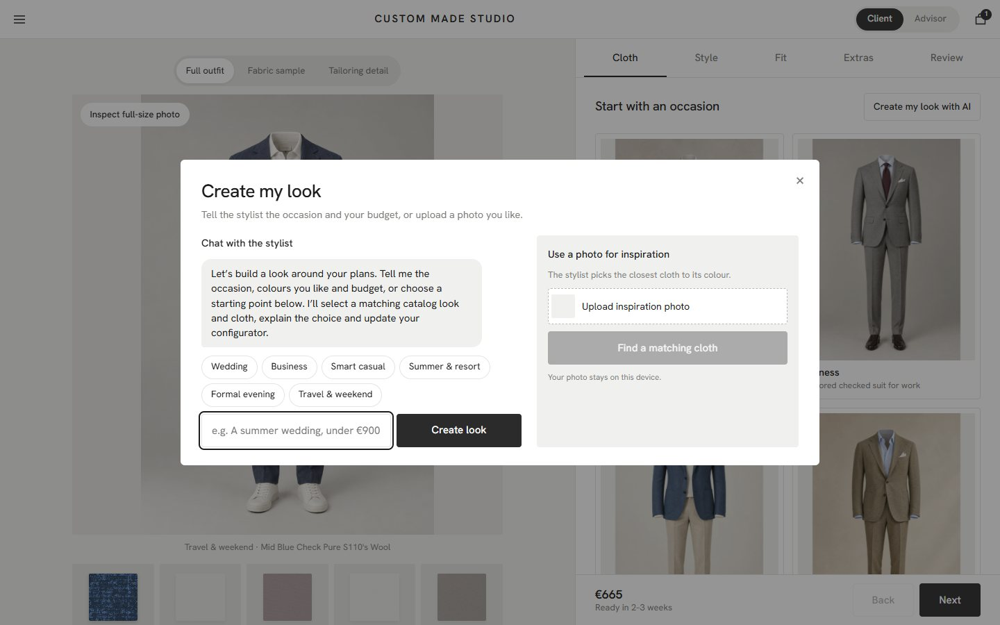
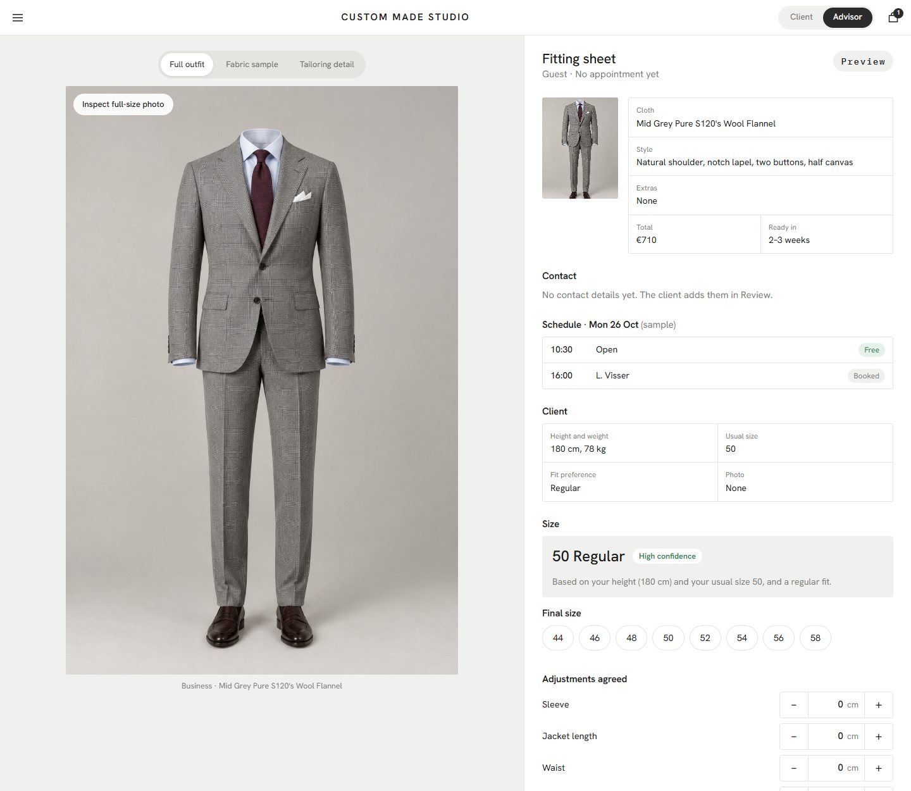
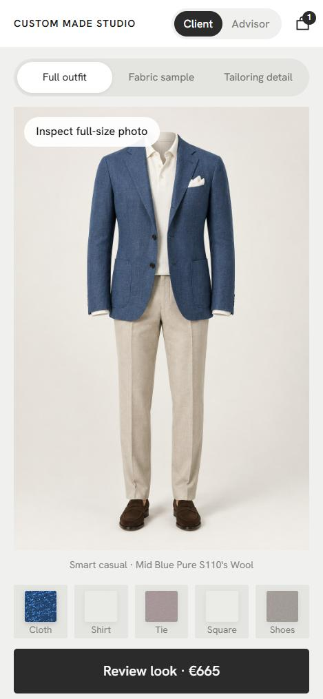

# Custom Made Studio

A made-to-measure suit configurator concept. Pick an occasion, match cloth to any colour or photo, get a size with a confidence label, and hand the look to a store advisor.

A learning project built with AI. Plain HTML, CSS and JavaScript. No framework, no build step.



## Screenshots

| Fabric sample | Style |
|---|---|
|  |  |

| Find my size | Size suggestion |
|---|---|
|  |  |

| Extras | Review |
|---|---|
|  |  |

| Stylist | Advisor mode |
|---|---|
|  |  |



## What it does

- **Eight occasion looks**, each with its own full-outfit photo, plus a fabric sample and a detail view.
- **Colour and photo matching.** Any colour, hex code or uploaded photo is matched to the closest of 16 cloths.
- **Style presets** that say what they change. Combinations that cannot be made are disabled with the reason.
- **Find my size.** One suggested size with a High, Medium or Low confidence label and the reason. A low result offers a store fitting. A size grid is there for people who know theirs.
- **Extras** in matching colours, each with its own photo, plus a monogram preview. Prices are itemised in euros.
- **Stylist.** Describe the occasion and budget, ask a question, or upload an inspiration photo. It works in the browser with no setup.
- **Client / Advisor switch.** Advisor mode shows a fitting sheet: the look, contact details, a sample schedule, the suggested and final size, adjustments and notes. It can be printed.
- **Remembers you on this device:** resume, a saved size, a link that reopens the design, and a calendar file for the fitting.

## Run it

```bash
python -m http.server 8770
```

Open http://localhost:8770. Use a local server rather than opening the file directly.

Useful links: `?mode=advisor`, `?tab=2` (steps 0 to 4), `?occ=wed`, `?brief=summer wedding`, `?stylist=open`, `?intro=0`.

## Files

```
index.html            the page
css/style.css         styles
js/data.js            cloths, occasions and extras
js/app.js             the configurator
js/assistant.js       the stylist
js/config.js          optional address of a hosted AI proxy
worker/               the proxy that keeps an AI key off the page
assets/img/           photos and textures
docs/preview/         screenshots
catalog-gallery.html  browse every image
```

## Optional: a hosted Claude

The stylist works without it. To let Claude answer, deploy `worker/claude-proxy.js` (a small Cloudflare Worker that holds the key as a secret) and put its address in `js/config.js`. Visitors never see a key. It is written to the documented API and has not been tested with a live key.

## Notes

An independent concept, not an official product of any brand. Photos were generated for this prototype. Prices, appointment times, availability and size suggestions are illustrative, not real fit advice. The code is MIT licensed.
