# Custom Made Studio

A made-to-measure suit configurator concept. Pick an occasion, match cloth to any colour or photo, get a size with a confidence label, and hand the look to a store advisor.

A learning project built with AI. Plain HTML, CSS and JavaScript. No framework, no build step.

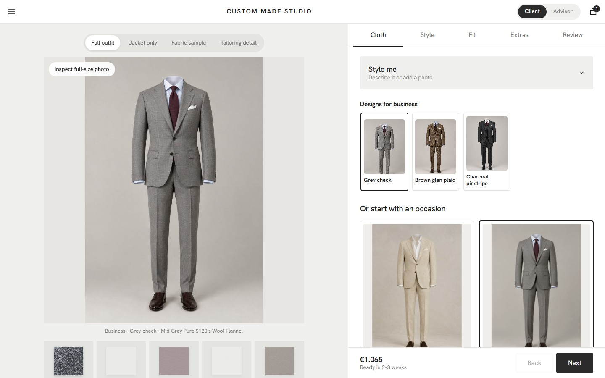

## Screenshots

| Jacket only | Fabric sample |
|---|---|
| 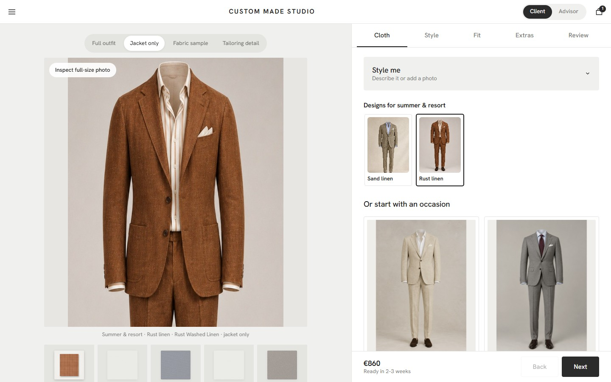 | 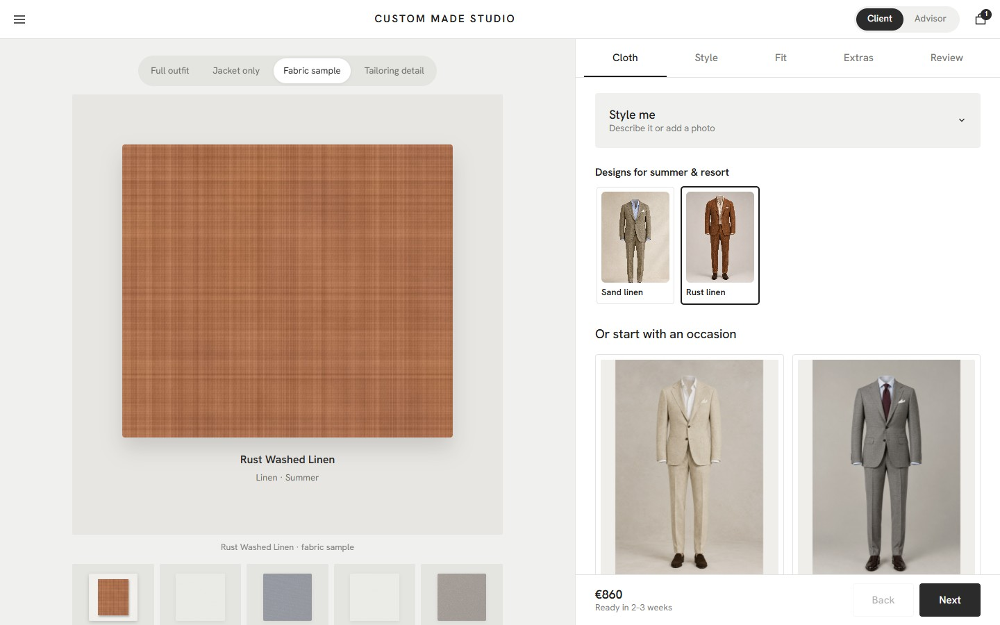 |

| Style | Find my size |
|---|---|
| 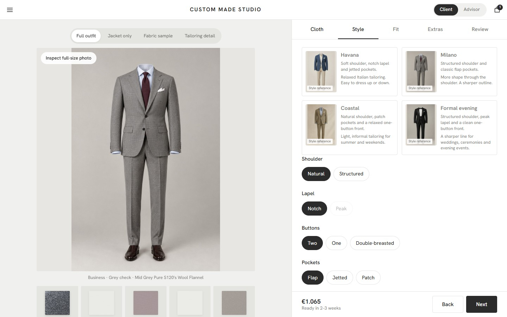 | 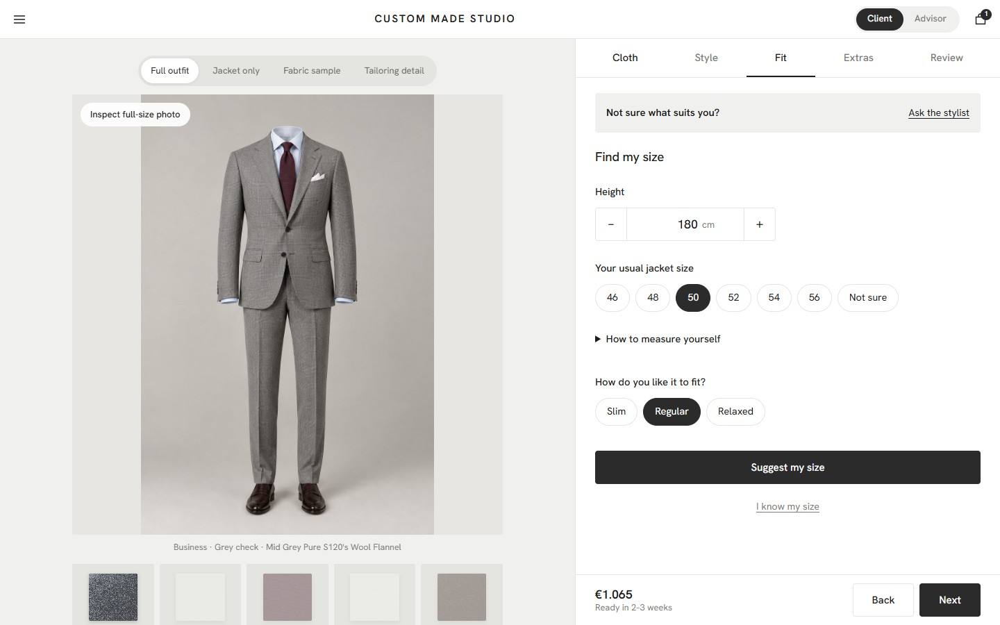 |

| Size and pants size | Extras |
|---|---|
| 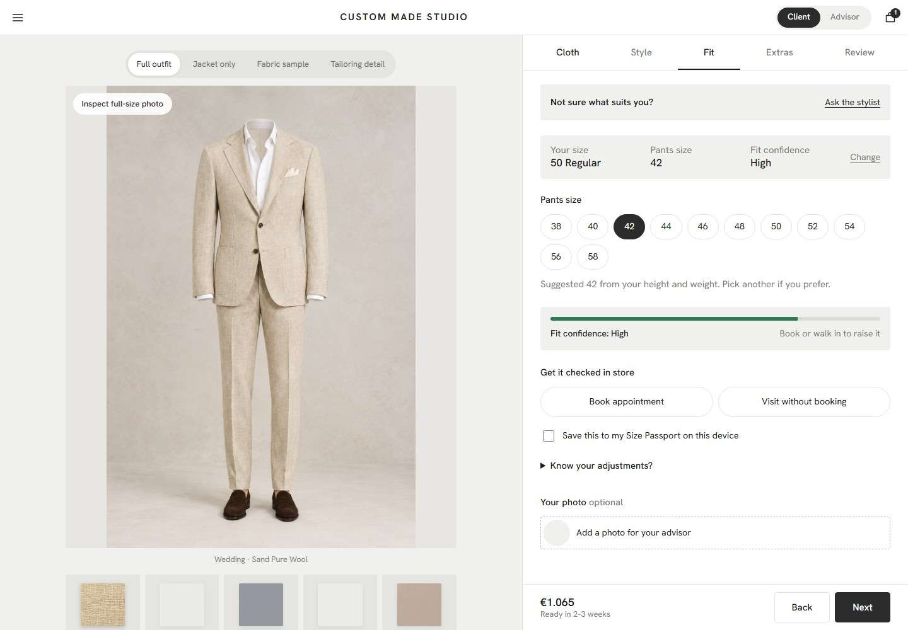 | 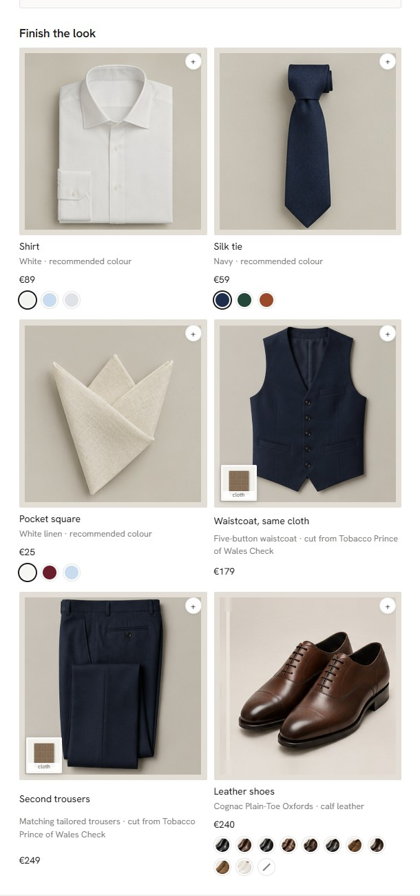 |

| Review | Style me |
|---|---|
| 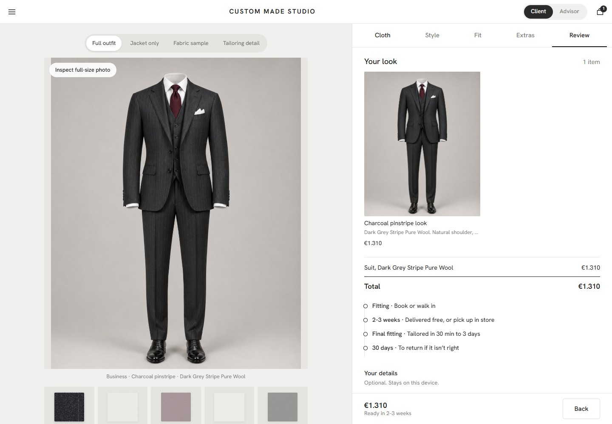 | 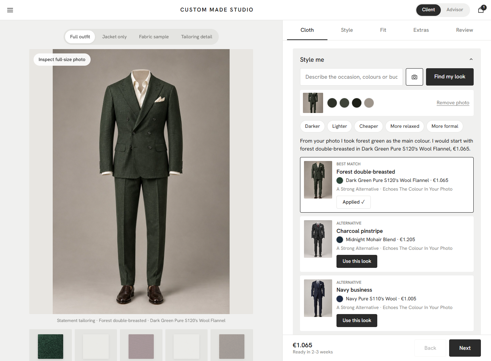 |

| Advisor mode | On a phone |
|---|---|
| 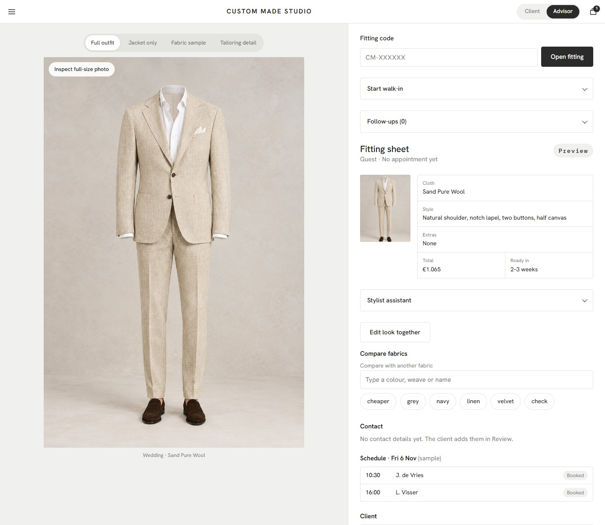 | 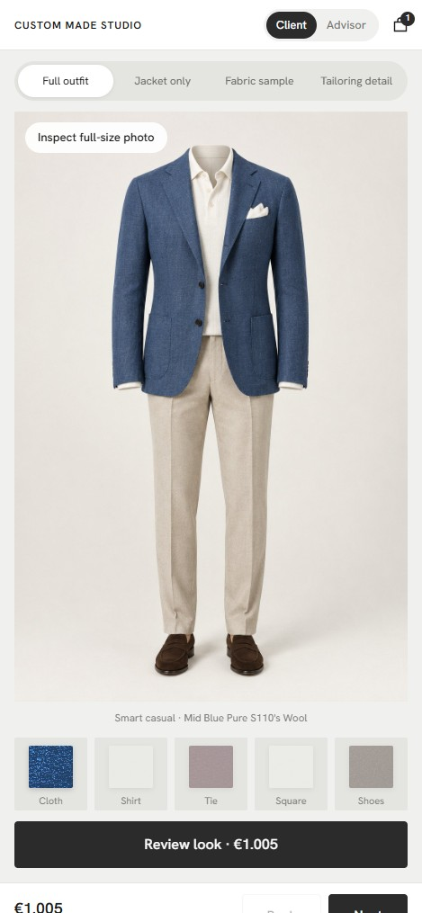 |

## What it does

The same page has two views, switched at the top right. The customer builds the suit. The style advisor uses the result to run the fitting.

### For the customer

- **Eight occasions and 13 designs.** Pick an occasion, then a design for it, each with a full-outfit photo. A jacket-only view, a fabric sample and a detail view show it closer.
- **Style me**, inside the Cloth step. It starts collapsed. Open it, type a line or add an inspiration photo and get three ranked looks, chosen from all 13 designs and 46 cloths. Tap a colour found in the photo to re-rank around it. Pick a look to apply it, or refine with Darker, Lighter, Cheaper, More relaxed or More formal. Questions get a short answer. It runs in the browser with no setup.
- **Colour and photo matching.** Any colour, hex code or uploaded photo is matched to the closest cloths.
- **Style presets** that say what they change. Combinations that cannot be made are disabled with the reason.
- **Find my size.** A suggested jacket size and pants size, with a High, Medium or Low confidence label and the reason. A low result offers a store fitting. A size grid is there for people who know theirs.
- **Extras** in matching colours, each with its own photo, ten shoe styles with their own prices, or no shoes, and a monogram preview. Prices are itemised in euros.
- **Remembers you on this device:** resume, a saved Size Passport with jacket and pants sizes, a link that reopens the design, and a calendar file for the fitting.

### For the style advisor

- **Open a fitting by its code**, or start a walk-in with the customer's name, occasion, event date and budget.
- **The fitting sheet:** the look, contact details, a sample schedule, the customer's brief, the suggested jacket and pants size with the reason, and a short "check first" list.
- **Record what happened:** the final jacket and pants size, one tap for why it changed (shoulders, chest, waist, length, posture, preference), the adjustments agreed in 0.5 cm steps, notes, and an outcome with a next step and a follow-up date.
- **Follow-ups:** customers who need a call back are listed by date.
- **Stylist assistant:** "Prepare this fitting", "Find a lower-priced fabric", "Explain this cloth", and a question box with quick questions such as "What should I ask first?" or "Is the size right?". It answers from the fitting and catalogue facts on the device, so it works without any cloud service. An optional hosted AI can be connected (see below).
- **Compare fabrics by keyword:** type a colour, weave or name (or "cheaper") and pick from the matches, with the price difference shown.
- **Measure what works:** each saved fitting records suggested against final size, so the sheet shows how often the suggestion held, by confidence level and for pants, and the most common reason for a change. The log can be exported as CSV, and each entry carries a version tag so a rule change can be compared before and after.

| Open a fitting or start a walk-in | Follow-ups |
|---|---|
| 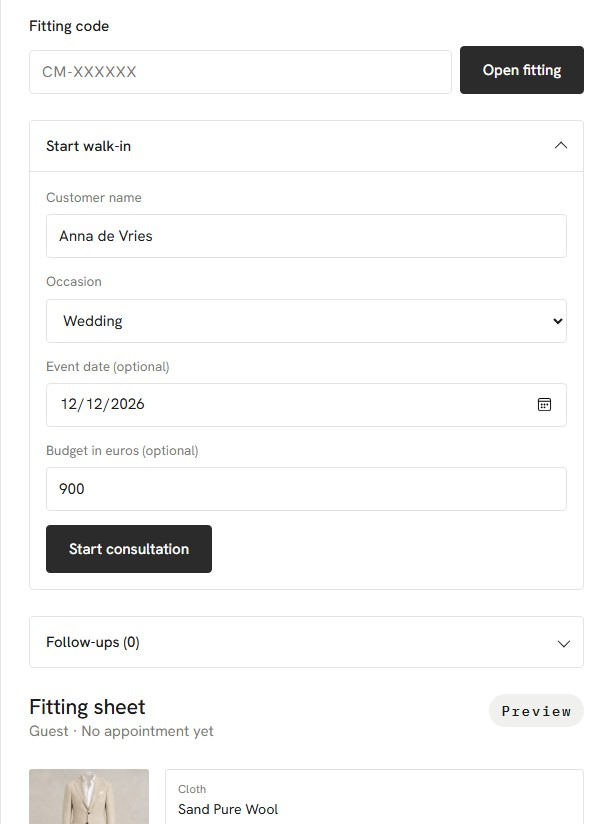 | 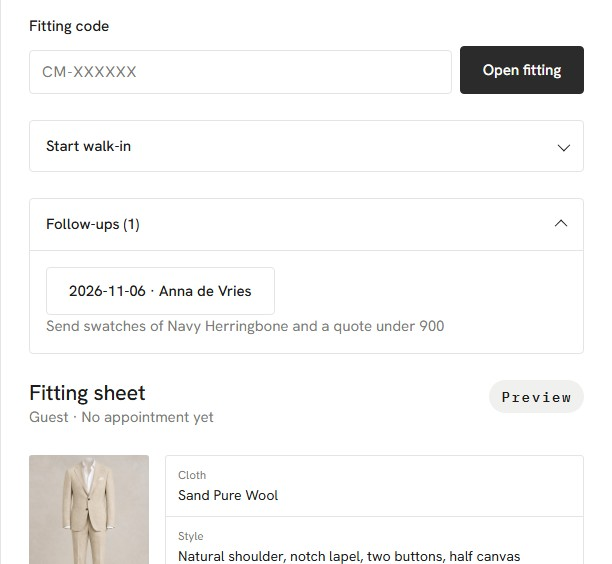 |

| Stylist assistant | Compare fabrics by keyword |
|---|---|
| 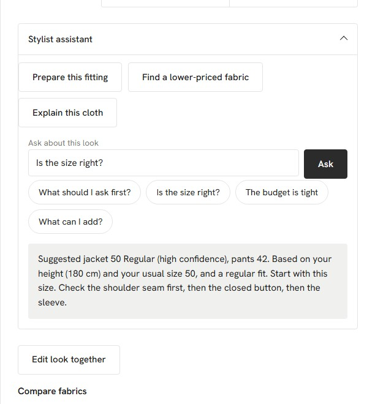 | 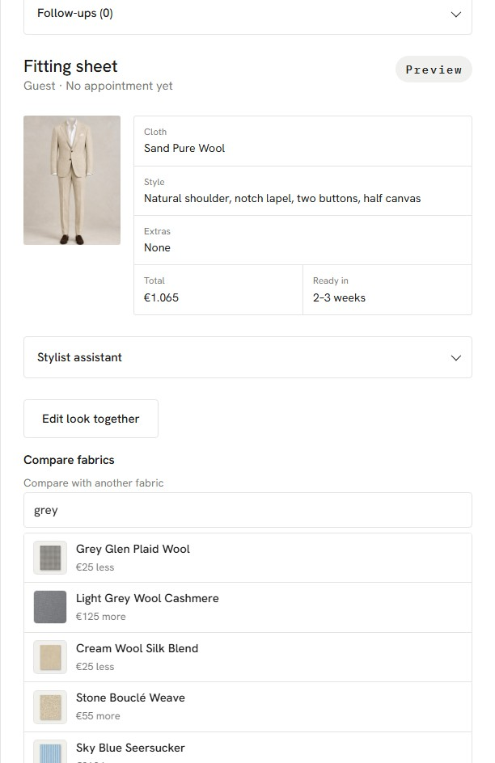 |

## Run it

```bash
python -m http.server 8770
```

Open http://localhost:8770. Use a local server rather than opening the file directly.

Useful links: `?mode=advisor`, `?tab=2` (steps 0 to 4), `?occ=wed`, `?design=brown-glen-plaid`, `?cloth=rust_linen`, `?view=jacket`, `?brief=summer wedding`, `?stylist=open`, `?intro=0`.

## One-file version

`python tools/build_standalone.py . Custom-Made-Studio-standalone.html` writes a single HTML file with the styles, scripts and all images inside (about 4 MB). It opens straight from a file and can be sent by email. Images are shrunk for size.

## Files

```
index.html            the page
css/style.css         styles
js/data.js            cloths, occasions and extras
js/app.js             the configurator
js/assistant.js       reads the line you type
js/stylist.js         palette sampling and look ranking
js/config.js          optional address of a hosted AI proxy
worker/               optional proxy that keeps an AI key off the page
tests/stylist-test.html  87 checks, open it on the local server
assets/img/           photos and textures
docs/preview/         screenshots
catalog-gallery.html  browse every image
```

## Optional: a hosted Claude

Style me works without it. To let Claude read the photo, deploy `worker/claude-vision-proxy.js` (a small Cloudflare Worker that holds the key as a secret) and put its address in `CUSTOM_STYLIST_AI_ENDPOINT` in `js/config.js`. Visitors never see a key. Answers are checked against the real catalogue, and if the service is down the page falls back to private matching. Not tested with a live key. The worker also contains image generation, which the page does not use.

## Image library

`assets/img/library` holds 102 concept images: 33 fabric swatches, 33 fabric textures, 13 suits, 13 jacket-only views and 10 standalone shoe styles. Textures are synthetic illustrations, not mill photographs. The shoe photos are crops from one generated studio board and have limited detail. Cloth names, compositions and all prices for the library items are fictional demo values, not retail prices.

## Notes

An independent concept, not an official product of any brand. Photos were generated for this prototype. Prices, appointment times, availability and size suggestions are illustrative, not real fit advice. The code is MIT licensed.
