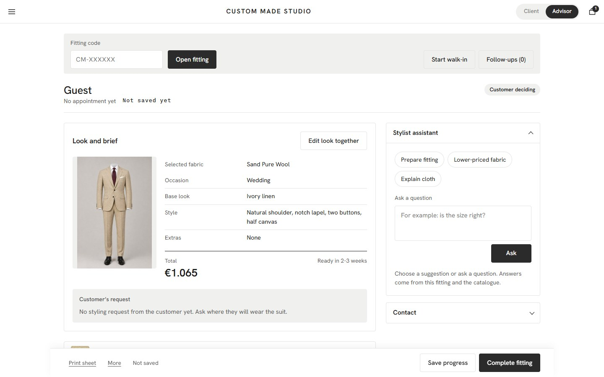
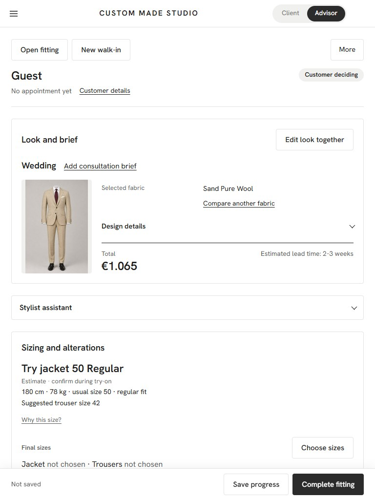
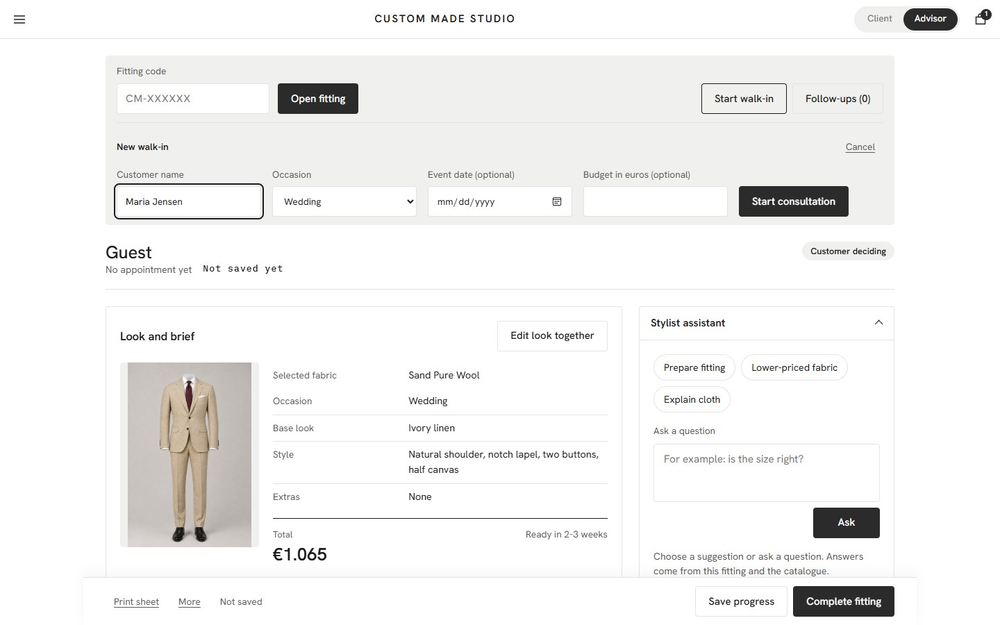
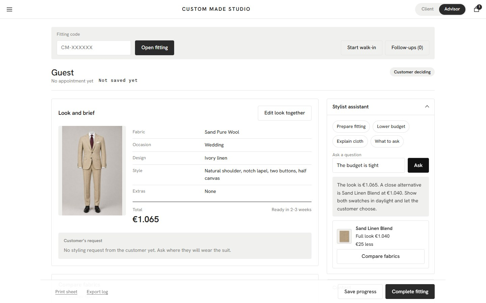
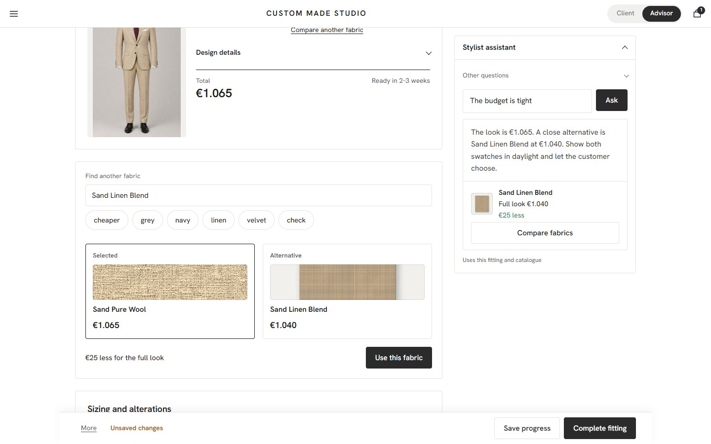
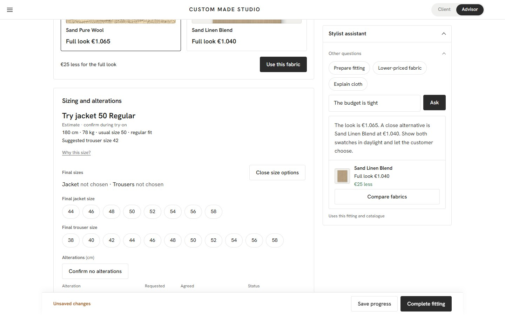
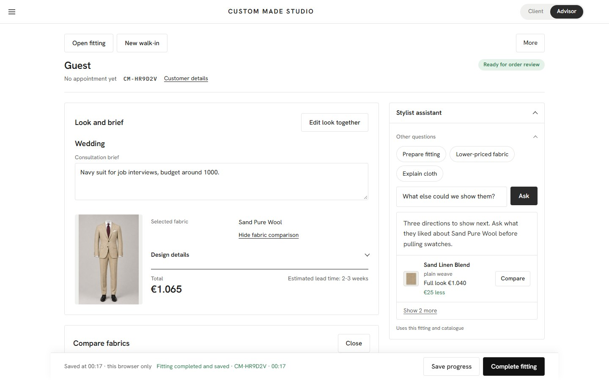

# Custom Made Studio

A made-to-measure suit configurator concept. Pick an occasion, match cloth to any colour or photo, get a size with a confidence label, and hand the look to a store advisor.

A learning project built with AI. Plain HTML, CSS and JavaScript. No framework, no build step.


## The problem I was trying to solve

Buying a made-to-measure suit is a good idea and a hard first step. Most people arrive with a feeling ("something navy for a job interview, not too expensive") and face hundreds of fabrics, unfamiliar words (half canvas, S110s, glen plaid), a size they are not sure of, and a price that grows with every choice. In store, the advisor then has to rebuild that conversation from scratch, so the first minutes go on re-asking what the customer already thought about.

This prototype explores one question: **can the customer arrive at a look and a rough size on their own, and can the advisor pick up exactly where they stopped?**

- **For the customer:** start from the occasion, a sentence or a photo instead of a catalogue. **Style me** reads what they type ("light linen suit for a summer wedding, under 900") or the colours in an inspiration photo and offers three looks, matched to the 13 designs and 46 fabrics. They see the price change as they choose, and get a starting size with an honest "confirm at the fitting" label.
- **For the advisor:** open the customer's look by code (or start a walk-in), see their request, and use the **stylist assistant** to prepare the fitting, suggest other fabrics inside the budget with the price of each, and explain a cloth in plain words. Then confirm sizes and alterations and save the fitting with a clear status. Nothing is hidden or overstated: unknown measurements say "Not provided", unreviewed alterations say "Not reviewed", and saved data says it is only on this device.

**Where the AI fits.** The project was built with AI, and Style me and the stylist assistant are the "smart" parts of the product. They run on rules and catalogue facts in the browser, so they work without any cloud service and never invent a fabric or a price. An optional hosted AI (Claude) can be connected through a protected proxy for free-text and photo questions; it is switched off in this repository, and no API key is ever stored in the browser files.

What it deliberately does not do: place orders, take payment, check stock, or claim that the size suggestion is validated. Those would be the next steps, and the ideas here are hypotheses to test with real customers and advisors, not results.

## Screenshots

| Jacket only | Fabric sample |
|---|---|
|  |  |

| Style | Find my size |
|---|---|
|  |  |

| Size and pants size | Extras |
|---|---|
|  |  |

| Review | Style me |
|---|---|
|  |  |

| Advisor mode | On a phone |
|---|---|
|  |  |

## What it does

The same page has two views, switched at the top right. The customer builds the suit. The style advisor uses the result to run the fitting.

### For the customer

- **Eight occasions and 13 designs.** Pick an occasion, then a design for it, each with a full-outfit photo. A jacket-only view, a fabric sample and a detail view show it closer.
- **Style me**, inside the Cloth step. It starts collapsed. Open it, type a line or add an inspiration photo and get three ranked looks, chosen from all 13 designs and 46 cloths. Tap a colour found in the photo to re-rank around it. Pick a look to apply it, or refine with Darker, Lighter, Cheaper, More relaxed or More formal. Questions get a short answer. It runs in the browser with no setup.
- **The suit photo follows the fabric.** Choose any of the 46 fabrics and the suit photo changes to that fabric. Every fabric has its own photo of the same classic suit.
- **Colour and photo matching.** Any colour, hex code or uploaded photo is matched to the closest cloths.
- **Style presets** that say what they change. Combinations that cannot be made are disabled with the reason.
- **Find my size.** A suggested jacket size and pants size, with a High, Medium or Low confidence label and the reason. A low result offers a store fitting. A size grid is there for people who know theirs.
- **Extras** in matching colours, each with its own photo, ten shoe styles with their own prices, or no shoes, and a monogram preview. Prices are itemised in euros.
- **Remembers you on this device:** resume, a saved Size Passport with jacket and pants sizes, a link that reopens the design, and a calendar file for the fitting.

### For the style advisor

- **A calm, compact workspace** (tablet first): customer name, appointment and fitting code at the top, and one slim toolbar (Open fitting, New walk-in, More). The code form, the walk-in form and Follow-ups open only when asked for. The stylist assistant stays in view beside the fitting on wide screens and folds under the look summary on a tablet.
- **Look and brief:** the occasion and the customer's request come first (or a small "Add consultation brief" action when there is none), then the full suit photo, the selected fabric with "Compare another fabric" beside it, design details folded away, the total and delivery estimate. Fabric search and the side-by-side comparison open only when asked for, and open by themselves when the assistant recommends an alternative.
- **Sizing and alterations:** the decision leads: "Try jacket 50 Regular", "Estimate · confirm during try-on", the measurements it is based on, and "Why this size?". Customer details and contact sit in one folded section. Final jacket and trouser sizes are shown compactly (Choose or Change sizes), with a reason for change only when a final size differs. Alterations show requested against agreed, with a status beside each row ("Not reviewed" or "Confirmed") and one "Confirm no alterations" button; workroom notes follow.
- **Appointment outcome and saving:** status, next step and follow-up date. A status line beside the buttons always says where things stand: Not saved, Unsaved changes, Saved at 14:32 in this browser, or Save failed. "Complete fitting" needs both final sizes and confirmed alterations; if something is missing the bar says "3 items need attention" (tap it to jump to the first), and a short message appears under each missing item.
- **Trust in what is on screen:** a walk-in shows "Not provided" for measurements until the customer gives them, and its starting size is labelled provisional. Opening another fitting or starting a walk-in with unsaved changes offers Save and switch, Discard changes or Keep editing. A customer photo opens with View customer photo, and contact details can be added during the appointment.
- **On a phone:** one slim bottom bar (Save progress, Complete fitting), Print sheet and Export log inside More in the top toolbar, a small suit thumbnail you can tap to enlarge, and alterations stacked so Requested and Agreed both stay visible.
- **Share with the customer:** More → Draft email summary opens a draft in the advisor's own mail app (addressed to the customer's email if known) with the look, total, final sizes, agreed alterations and next step. Nothing is sent until the advisor presses send, and internal workroom notes are never included. Print sheet gives a clean page headed "Consultation summary, no order placed" that can also be saved as a PDF.
- **Printing:** a plain sheet headed with the fitting code and print date, marked DRAFT until the fitting is completed, with unreviewed alterations printed as "Not reviewed".
- **Stylist assistant:** three shortcuts (Prepare fitting, Lower-priced fabric, Explain cloth) and a question box that sits beside a small Ask button, with the other questions folded away once it has answered. When it suggests another fabric it shows the name, new total and difference with a Compare fabrics button. Ask "What else could we show them?" and it answers with up to three option cards, the strongest first and the rest behind "Show 2 more" (different weaves, within budget, tagged "Shown online" if the customer already saw them), each with its own Compare button. It answers on the device without any cloud service; an optional hosted AI can be connected (see below).
- **Measure what works:** each saved fitting records suggested against final size, exported as CSV with a version tag for the sizing rules.

| Advisor workspace on a tablet | Start a walk-in |
|---|---|
|  |  |

| Stylist assistant and a cheaper fabric | Compare fabrics |
|---|---|
|  |  |





## Get it and run it

Nothing to install except Python (or any static web server). It is plain HTML, CSS and JavaScript with no build step.

1. Download it: on the GitHub page press the green **Code** button, then **Download ZIP**, and unzip it. Or clone it:

```bash
git clone https://github.com/zeniusz/made-to-order-shop.git
cd made-to-order-shop
```

2. Start a local server inside that folder:

```bash
python -m http.server 8770
```

3. Open http://localhost:8770 in your browser. Use a local server rather than opening `index.html` directly, because the page loads its scripts and images by path.

Prefer not to run anything? Open the live version at https://zeniusz.github.io/made-to-order-shop/, or use the one-file version below, which opens straight from a file.

Useful links: `?mode=advisor` (opens the Style Advisor), `?tab=2` (steps 0 to 4), `?occ=wed`, `?design=brown-glen-plaid`, `?cloth=rust_linen`, `?view=jacket`, `?brief=summer wedding`, `?stylist=open`, `?intro=0`.

Everything you do is saved only in your own browser on that device. Prices, cloth names and availability are fictional demo values.

Tests: open `tests/stylist-test.html` through the local server for the 144 in-browser checks. `tests/walkthrough.py` (needs Playwright) runs one full fitting on a phone-sized screen: walk-in, brief and contact, fabric change, sizes, a -1.5 cm alteration, completion, reload and reopen by code, the unsaved-changes guard, the email draft and an A4 print.

## One-file version

`python tools/build_standalone.py . Custom-Made-Studio-standalone.html` writes a single HTML file with the styles, scripts and all images inside (about 4 MB). It opens straight from a file and can be sent by email. Images are shrunk for size.

A ready-made copy is in the repository: [dist/Custom-Made-Studio-standalone.html](dist/Custom-Made-Studio-standalone.html). Open that file on GitHub and press **Download raw file** (the download icon), then double-click it. No server, no install.

## Files

```
index.html            the page
css/style.css         styles
js/data.js            cloths, occasions and extras
js/app.js             the configurator
js/assistant.js       reads the line you type
js/stylist.js         palette sampling and look ranking
js/config.js          optional address of a hosted AI proxy
worker/               optional proxy that keeps an AI key off the page
tests/stylist-test.html  96 checks, open it on the local server
assets/img/           photos and textures
docs/preview/         screenshots
catalog-gallery.html  browse every image
```

## Optional: a hosted Claude

Style me works without it. To let Claude read the photo, deploy `worker/claude-vision-proxy.js` (a small Cloudflare Worker that holds the key as a secret) and put its address in `CUSTOM_STYLIST_AI_ENDPOINT` in `js/config.js`. Visitors never see a key. Answers are checked against the real catalogue, and if the service is down the page falls back to private matching. Not tested with a live key. The worker also contains image generation, which the page does not use.

## Image library

`assets/img/library` holds the concept images: 33 fabric swatches, 33 fabric textures, 13 suits, 13 jacket-only views and 10 standalone shoe styles from the supplied pack, plus 41 photos of the classic suit in each fabric (`cloths`). The fabric photos were made with an image generator from the classic navy suit photo and each fabric's swatch, three at a time on one sheet, then cut apart, so they are illustrations and the weave detail is approximate. Textures are synthetic. The shoe photos are crops from one generated board. Cloth names, compositions and all prices are fictional demo values, not retail prices.

## Notes

An independent concept, not an official product of any brand. Photos were generated for this prototype. Prices, appointment times, availability and size suggestions are illustrative, not real fit advice. The code is MIT licensed.
