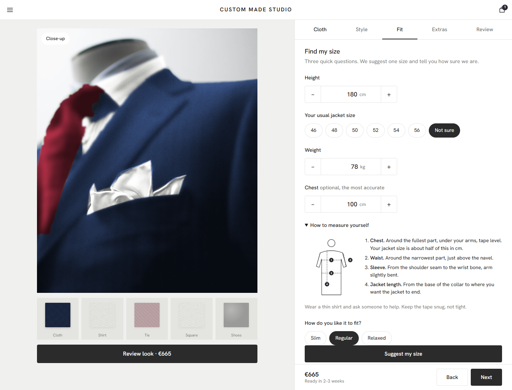

# Custom Made Studio

A learning project: using AI to build a realistic, working product page instead of a mock-up.

The idea was to test how far an AI-assisted build can go with a made-to-measure suit configurator, and what it takes to make the result feel like a real shop rather than a drawing.


| Picker | Sand cloth | Review | Phone |
|---|---|---|---|
|  |  |  |  |

| Find my size: high confidence | Find my size: low confidence, store fallback |
|---|---|
|  |  |

| The stylist | Style choices that tell you what changed | Measure yourself |
|---|---|---|
|  |  |  |

## What I wanted to learn

- **Real imagery, not illustration.** Can a single free photograph be recoloured in the browser so that changing the cloth looks like a different jacket, with folds, shadows and lapel intact?
- **How colour changes the look.** What happens to a whole outfit when the cloth, shirt, tie and pocket square change together, and can the page suggest colours that go with each other?
- **Guided choices instead of long lists.** Start from an occasion, a colour or a photo, rather than scrolling hundreds of fabrics.
- **A size step that explains itself.** Three short screens: tell us about you, get one suggested size with a High / Medium / Low confidence label and a plain reason, and fall back to a store measurement when confidence is low. People who know their size can skip to a grid.
- **Hand-off to a person.** A short code that fills a store-advisor screen with the look, the size and a "check first" list.
- **Working with AI on a real build.** Planning, researching, building, testing in a browser, fixing what looks wrong, and publishing.

## What it does

- Recolours a real jacket photo live. Shirt, tie and pocket square recolour too.
- First-visit picker by occasion (Interview, Office, Wedding, Evening, Travel).
- Match any colour, hex code or uploaded photo to the closest cloths using perceptual colour distance (CIELAB ΔE). Filter by season.
- **Plain-language cloth notes.** Names like "S120's" or "Wrinkle-Free 4-Ply" are explained next to the cloth, so nobody needs to know the jargon.
- Style presets (Havana, Milano) that say exactly what they changed, and rules that grey out combinations that do not go together, with the reason.
- **Find my size**: suggested size, High / Medium / Low confidence with a plain reason, store fallback (book appointment or walk-in), expert size grid with Regular / Short / Long.
- Extras in matched colours, price shown line by line in euros.
- Store code and a store-advisor screen.
- **Remembers you, on this device only.** Resume where you left off, a Size Passport for your saved size, and a link that reopens the exact design.
- **Measure yourself.** A short illustrated guide and an optional chest field for a more accurate size.
- **Add the fitting to your calendar** as a calendar file with the store code in it.
- **Close-up.** Hover or touch the jacket to magnify the weave.

## The stylist (AI)

A chat at the top of the Cloth step. Type what you need and it does the choosing, or ask a question.

- **"Navy suit for a summer wedding, 183 cm, 80 kg, slim fit"**: picks the occasion, season, colour, texture and budget it finds, fills in your height, weight and fit preference, ranks the cloths and explains why the top one won.
- **"What does S120's mean?" / "What is half canvas?" / "How long is delivery?"**: answers from the facts the page already shows.
- **"Something cheaper", "darker", "a finer cloth"**: changes the choice and says by how much.
- **"What size am I?", "book a fitting", "what tie goes with this?"**: takes you to the right step with a suggestion.

It works for everyone with no setup. The built-in reader runs entirely in the browser and sends nothing anywhere.

**Connecting a hosted Claude (optional, for the site owner).** A static page cannot keep a secret key, so visitors never see or enter one. Instead, deploy `worker/claude-proxy.js` (a small Cloudflare Worker that holds the key as a secret), then put its address in `js/config.js`. From then on each message is answered by Claude, and if the worker is down or unset the built-in reader answers. The worker is written to Anthropic's documented API but has not been tested against a live key.

Shareable views: `?occ=wed` (int, off, wed, eve, trv), `?tab=4` (step 0–4), `?intro=0` (skip the first-visit picker), `?brief=...` (send that sentence to the stylist).

## Run it

A static site with no build step and no dependencies.

```bash
python -m http.server 8770
```

Then open http://localhost:8770. Use a local server, not `file://`: the recolouring reads pixels from a canvas, which browsers block for files opened directly.

## How the recolouring works

`js/recolor.js` loads four images made from the source photo:

| File | Purpose |
|---|---|
| `suit-base.jpg` | the photo, cropped |
| `suit-plain.jpg` | luminance with the pinstripes and tie pattern blurred out inside their masks |
| `suit-mask.png` | soft masks: red = jacket, green = tie, blue = pocket square |
| `suit-mask-shirt.png` | soft mask for the shirt |

For each jacket pixel the brightness relative to the jacket's average drives the chosen colour, multiplied by a real wool texture (or a tweed photo for herringbone). A linear-then-soft tone curve keeps dark colours true and stops light ones from clipping. Tie, square and shirt are blended on top of the recoloured jacket.

## Project structure

```
index.html
css/style.css
js/data.js        catalogue and options
js/recolor.js     photo recolouring engine
js/app.js         configurator logic and UI
js/assistant.js   the stylist: built-in reader, facts, optional hosted Claude
js/config.js      optional address of the hosted Claude proxy
worker/           the proxy that keeps the API key off the page
assets/img/       photos, masks and textures
docs/             screenshots and learning notes
tools/            script that builds the masks from the source photo
```

## Data and disclaimer

This is an independent experiment and not an official product of any brand. Cloth names were taken from a public online configurator for realism. Prices in euros, style options, extras, appointment times and the size suggestion are illustrative and not real fit advice.

## Credits and licences

- Suit on mannequin: photo by Paul Goyette, [CC BY-SA 2.0](https://commons.wikimedia.org/wiki/File:Grey_and_navy_suit_on_mannequin.jpg). The cropped image, masks and recoloured output are adaptations and are shared under CC BY-SA 2.0.
- Wool herringbone texture: Rico Cilliers and colormass via Poly Haven, CC0.
- "Tweed 1": public domain.

All images via Wikimedia Commons. `tools/make_masks.py` regenerates the masks from the original photo. The code is MIT licensed (see `LICENSE`).
