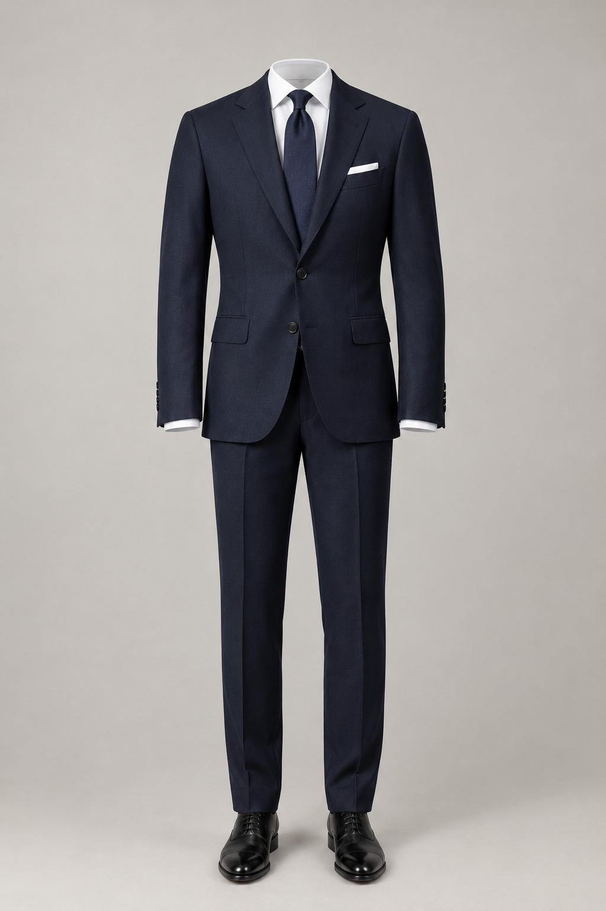
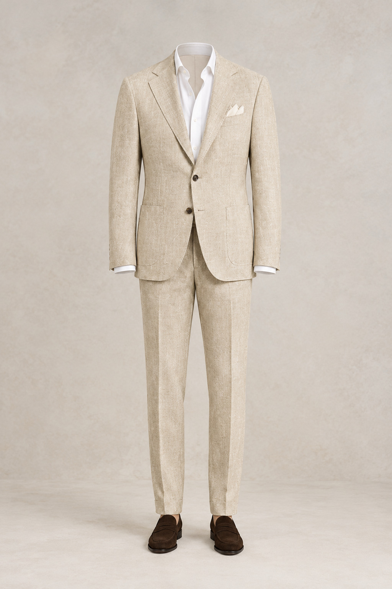
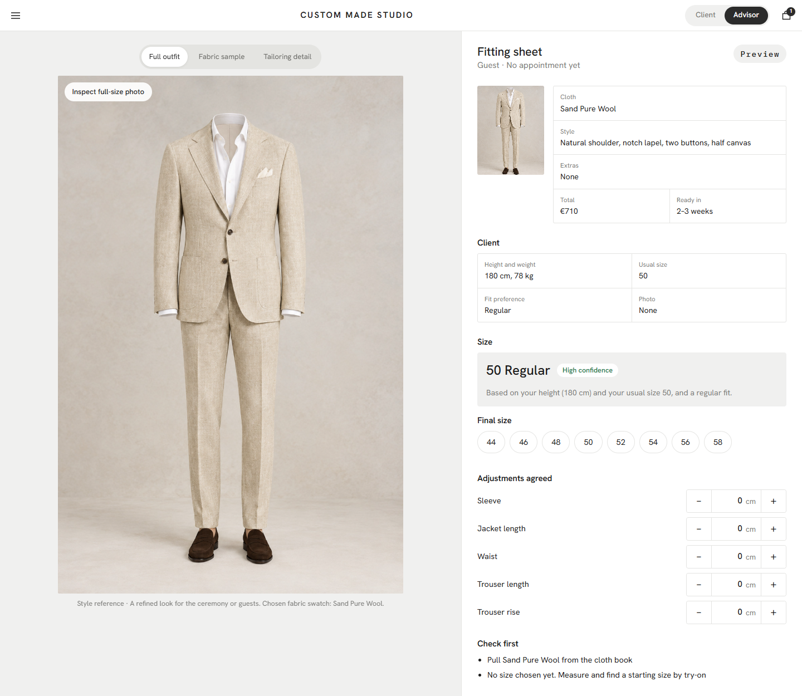

# Custom Made Studio

**A made-to-measure suit configurator concept.** Pick an occasion, match cloth to any colour or photo, get a size suggestion with a plain-language confidence label, and hand the finished look to a store advisor.

Built as a learning project to explore how AI can help design and build a realistic shopping experience: full-outfit photography, fabric swatches, a guided size step, colour-matched extras and a conversational stylist, all in a static site with no build step.

## About

| | |
|---|---|
| **What it is** | A front-end prototype of a made-to-measure suit studio. |
| **Who it is for** | First-time suit buyers who find long fabric lists and size grids hard, and the store advisors who finish the fitting. |
| **What it explores** | Occasion-led choice, colour and photo matching, explained fabric jargon, a size step that says how sure it is, and a clean hand-off to a person. |
| **Tech** | Plain HTML, CSS and JavaScript. No framework, no dependencies, no build. |
| **Status** | Working prototype. Prices, appointment times and size suggestions are illustrative. |





Screenshots for the occasion catalog, style presets, accessory colour catalog, monogram preview and the advisor's fitting sheet are in `docs/screenshots/`.



## What I wanted to learn

- **Distinct catalog imagery.** Each occasion has its own original, full-resolution catalog photograph. The interface never recolours a suit photograph and pretends the result is a different cloth.
- **How colour changes the look.** What happens to a whole outfit when the cloth, shirt, tie and pocket square change together, and can the page suggest colours that go with each other?
- **Guided choices instead of long lists.** Start from an occasion, a colour or a photo, rather than scrolling hundreds of fabrics.
- **A size step that explains itself.** Three short screens: tell us about you, get one suggested size with a High / Medium / Low confidence label and a plain reason, and fall back to a store measurement when confidence is low. People who know their size can skip to a grid.
- **Hand-off to a person.** A Client / Advisor switch that turns the page into a fitting sheet with the look, the size and a "check first" list.
- **Working with AI on a real build.** Planning, researching, building, testing in a browser, fixing what looks wrong, and publishing.

## What it does

- Eight distinct occasion-led looks: Wedding, Business, Smart casual, Summer & resort, Formal evening, Interview, Travel & weekend, and Statement tailoring. Wedding and lifestyle-led looks appear first, rather than making business tailoring the only starting point.
- A full outfit image for each category; the selected cloth is shown separately as a textile sample, without recolouring the product photo.
- Match any colour, hex code or uploaded photo to the closest cloths using perceptual colour distance (CIELAB ΔE). Filter by season.
- **Plain-language cloth notes.** Names like "S120's" or "Wrinkle-Free 4-Ply" are explained next to the cloth, so nobody needs to know the jargon.
- Four image-led style presets (Havana, Milano, Coastal and Formal evening) state which tailoring details they change, and incompatible combinations are disabled with an explanation.
- **Find my size**: suggested size, High / Medium / Low confidence with a plain reason, store fallback (book appointment or walk-in), expert size grid with Regular / Short / Long.
- Extras have their own product photographs. Shirts, ties, pocket squares and shoes switch to a matching catalog photo when a supported colour is selected; waistcoat and second-trouser cards show a style reference alongside a swatch of the selected cloth. The monogram is a visible embroidery-preview option in Extras and appears again in Review and the price list. Prices are itemised in euros.
- **Client / Advisor switch.** The switch in the header turns the page into an advisor's fitting sheet: the look, the client's contact details (email and phone, tap to open), a sample schedule for the day showing which slots are free or booked, the client's numbers, the suggested size with its confidence, the final size, agreed adjustments, a check-first list and notes. Saving a fitting keeps a local tally of how often the suggested size matched the final one, and the sheet can be printed.
- Store code that identifies the saved look.
- **Remembers you, on this device only.** Resume where you left off, a Size Passport for your saved size, and a link that reopens the exact design.
- **Measure yourself.** A short illustrated guide and an optional chest field for a more accurate size.
- **Fitting slots show availability.** Some times are marked as taken and cannot be chosen (sample data). Contact details are optional and stay on the device.
- **Add the fitting to your calendar** as a calendar file with the store code in it.
- **Three product views.** Full outfit, a close crop from the selected catalog look, and a large fabric swatch. Open the original full-resolution outfit image to inspect details.

## The stylist (AI)

A compact stylist modal keeps the Cloth step focused. Open it from Cloth or Fit, choose one of the starter prompts, describe what you need, or upload an inspiration photo.

- **"Navy suit for a summer wedding, 183 cm, 80 kg, slim fit"**: picks the occasion, season, colour, texture and budget it finds, fills in your height, weight and fit preference, ranks the cloths and explains why the top one won.
- **"What does S120's mean?" / "What is half canvas?" / "How long is delivery?"**: answers from the facts the page already shows.
- **"Something cheaper", "darker", "a finer cloth"**: changes the choice and says by how much.
- **"What size am I?", "book a fitting", "what tie goes with this?"**: takes you to the right step with a suggestion.

The built-in stylist uses a structured local style assistant for occasion, colour, season, weave, size and budget prompts, then updates the actual catalog look and ranks the photographic fabric swatches. It samples dominant colours from an uploaded inspiration photo in the browser; images are not uploaded. It is an MVP for inspiration-based matching, not a generative image editor. A future version could send the brief and reference image to a protected image-generation endpoint to create a brand-new visual instead of adapting the configurator look. The optional hosted Claude endpoint can improve natural-language responses once configured.

**Connecting a hosted Claude (optional, for the site owner).** A static page cannot keep a secret key, so visitors never see or enter one. Instead, deploy `worker/claude-proxy.js` (a small Cloudflare Worker that holds the key as a secret), then put its address in `js/config.js`. From then on each message is answered by Claude, and if the worker is down or unset the built-in reader answers. The worker is written to Anthropic's documented API but has not been tested against a live key.

Shareable views: `?mode=advisor` (open the advisor's fitting sheet), `?occ=wed` (int, off, wed, eve, trv, cas, sig, res), `?tab=4` (step 0–4), `?brief=...` (send that sentence to the stylist).

## Run it

A static site with no build step and no runtime dependencies.

```bash
python -m http.server 8770
```

Then open http://localhost:8770. Use a local server, not `file://`, so image uploads, modal behavior and the browser session work consistently.

## Project structure

```
index.html                         configurator interface
css/style.css                      layout and responsive design
js/data.js                         cloths, occasions and extras catalog
js/app.js                          configurator logic and UI
js/assistant.js                    local stylist rules and optional hosted Claude
js/config.js                       optional address for the hosted assistant proxy
worker/                            proxy that keeps an AI key off the page
assets/img/catalog/                eight independent high-resolution outfit photographs
assets/img/extras/                 accessory catalog photos
assets/img/extras/variants/        17 shirt, tie, pocket-square and shoe colour photos
assets/img/textures/macro/         six high-resolution textile macro images
assets/img/textures/swatches/      16 separate color-and-weave swatch images
catalog-gallery.html               browse all images and swatches locally
assets-catalog.json                image inventory manifest
docs/                              screenshots and learning notes
```

The eight occasion photos are independent generated images. They are never tinted when the selected cloth changes. Every one of the 16 cloth choices has a separate textile swatch image, and the accessory cards use their own product photos. Shirts, ties, pocket squares and shoes switch to a matching catalog photo when the user chooses a supported colour. Waistcoat and second-trouser cards show a style reference alongside a swatch of the selected fabric; they do not imply that the navy reference photo is already recoloured.

## Complete visual catalog

Open `catalog-gallery.html` from the local server to browse the occasion looks, each cloth swatch, the six macro texture sources, accessory product references and their colour variants. All images are stored locally under `assets/img/` and included in this repository.

## Prototype scope

This is an independent configurator concept, not an official product of any brand. The outfit photographs were generated for this prototype and do not represent specific purchasable products. Cloth names use a realistic catalog-style dataset; euro prices, style options, extras, appointment times and the size suggestion are illustrative and not real fit advice.

## Credits and licences

All suit and accessory photos, textile macro sources, and color-mapped fabric swatches were generated or prepared specifically for this prototype. They are illustrative style references, not exact representations of goods for sale. The code is MIT licensed (see `LICENSE`).
